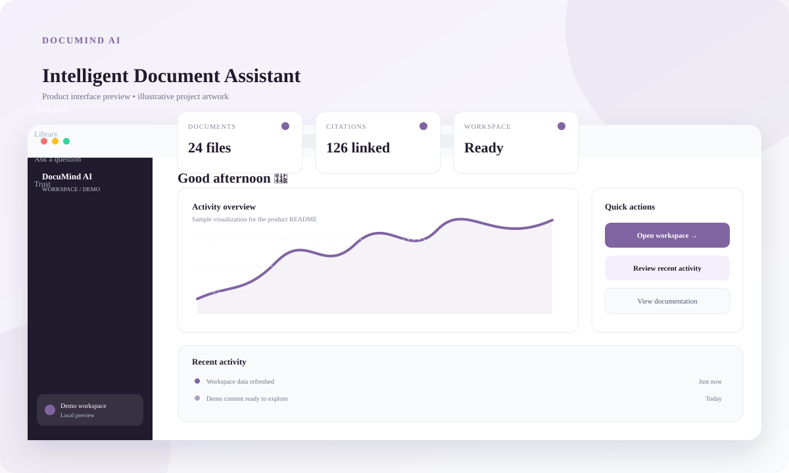
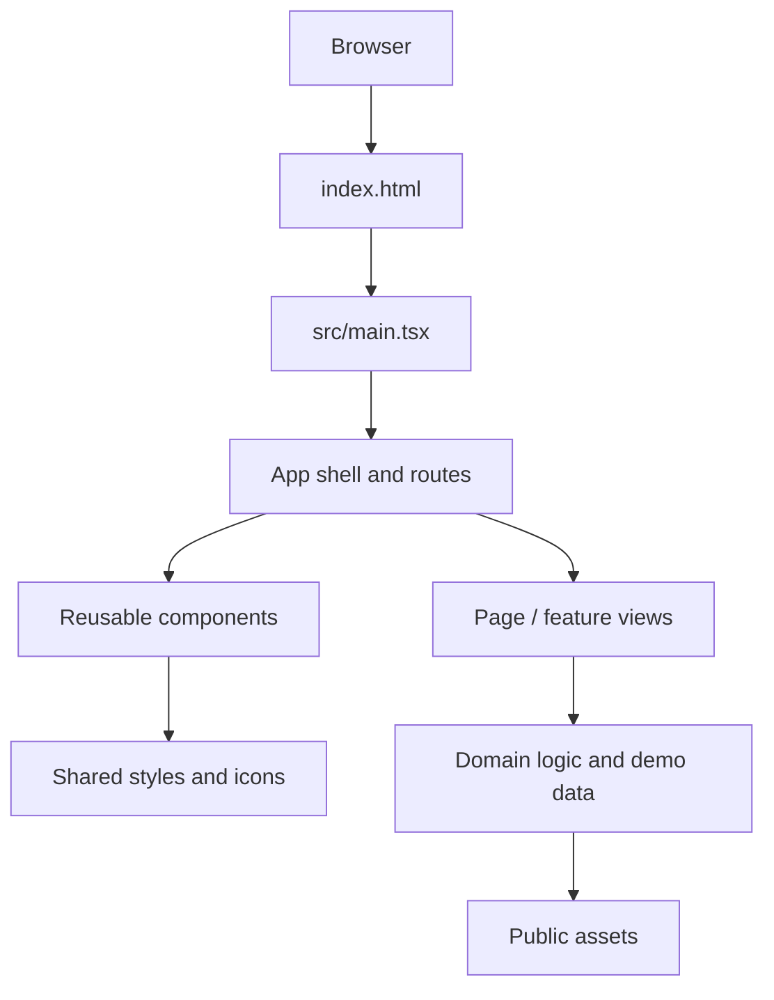

<div align="center">

# DocuMind AI

### Intelligent Document Assistant

**A polished React + TypeScript product prototype**



[Quick start](#-quick-start) · [Features](#-product-overview) · [Architecture](#-architecture) · [Quality checks](#-quality--verification) · [Limitations](#-important-limitations)

</div>

---

## Product overview

A document workspace concept for reviewing files, asking questions, and tracing answers back to source passages.

This repository is organized as a Vite application with reusable React components, typed source files, and bundled public assets. The graphic above is an **illustrative README preview**, not a claim that a live browser screenshot or production service was captured.

## Product highlights

- Document-focused landing and workspace routes
- PDF.js dependency for PDF document workflows
- Studio and architecture explainer pages
- Trust and citation-oriented product messaging
- Responsive React Router navigation

## Interface preview

The preview artwork in [`docs/preview.svg`](docs/preview.svg) is intentionally stored in the repository so it renders directly on Git hosting platforms and remains available offline. It shows the intended visual hierarchy—navigation, summary cards, a primary activity panel, quick actions, and recent activity—without pretending to be a verified runtime screenshot.

## Technology

- **React · TypeScript · Vite · Tailwind CSS · React Router · Framer Motion · Lucide · PDF.js**
- **Build tooling:** Vite and TypeScript project references
- **Code quality:** ESLint configuration included
- **Static assets:** `public/` and `src/assets/`

## Quick start

### Requirements

- Node.js 20.19+ or 22.12+ recommended (use a currently supported LTS release)
- npm
- Internet access for installing packages and for any external data services the app uses

### Install and run

```bash
npm ci
npm run dev
```

Vite prints the local development address in the terminal (normally `http://localhost:5173`). Open that address in a modern browser.

### Production build and preview

```bash
npm run build
npm run preview
```

### Lint

```bash
npm run lint
```

Run the build and lint commands after changes. A successful development-server start alone does not guarantee a clean TypeScript build.

## Repository map

```text
.
├── public/                 # Static images, favicon, and public assets
├── docs/
│   └── preview.svg         # README product-interface preview artwork
├── src/
│   ├── assets/             # Imported source assets (where used)
│   ├── components/         # Reusable UI and feature components
│   ├── pages/              # Route-level screens (where applicable)
│   ├── lib/                # Shared helpers / domain logic (where applicable)
│   ├── context/             # Shared React state (where applicable)
│   ├── data/                # Demonstration data (where applicable)
│   ├── types/               # Shared TypeScript types (where applicable)
│   ├── App.tsx              # Application shell and routing
│   ├── index.css            # Global styles and design tokens
│   └── main.tsx             # React entry point
├── index.html
├── package.json
├── package-lock.json
├── tsconfig*.json
├── vite.config.ts
└── eslint.config.js
```

### Key files

- `src/components/Layout.tsx` — shared shell and route outlet
- `src/pages/Home.tsx` — marketing and feature overview
- `src/pages/Workspace.tsx` — document workspace experience
- `src/pages/Architecture.tsx` — system architecture content
- `src/pages/Studio.tsx` — product studio experience
- `src/pages/Trust.tsx` — privacy/trust information
- `public/images/` — bundled product photography and illustrations

## Architecture



The diagram describes the front-end flow, not a deployed cloud architecture. Any backend, authentication provider, persistence layer, or AI service must be configured separately if required.

## Quality & verification

Before submitting changes:

1. Run `npm ci` from this folder to install the exact lockfile dependencies.
2. Run `npm run lint` and resolve reported warnings/errors.
3. Run `npm run build` and confirm TypeScript and Vite both finish successfully.
4. Open the app at desktop and mobile widths; test every navigation item, modal, form, filter, and empty/error state.
5. Check browser DevTools for failed network requests, missing assets, and runtime exceptions.
6. Verify keyboard focus, visible labels, and reduced-motion behavior for interactive elements.

### Troubleshooting

- **Install fails:** check Node/npm versions and network access, then retry `npm ci`.
- **Port is occupied:** use the alternate port Vite offers, or run `npm run dev -- --port 5174`.
- **Assets do not load:** public assets should be referenced from the root, for example `/images/example.jpg`.
- **Build fails after edits:** inspect the first TypeScript/ESLint error first; later messages can be cascading errors.
- **External lookups fail:** browser privacy settings, CORS, rate limits, or network restrictions may block third-party endpoints.

## Important limitations

This repository is a front-end prototype. Verify PDF processing and AI answer generation against the actual implementation before presenting them as production-backed; no server/API credentials are bundled.

Do not commit API keys, private user data, credentials, or production environment files. Keep secrets on a server, not in `VITE_*` variables, because Vite exposes those values to client-side code.

## License and attribution

No license was added by this README. Confirm ownership and third-party asset/font licenses before redistributing the project publicly.

---

<div align="center">

**Built for clarity, maintainability, and responsible iteration.**

</div>
